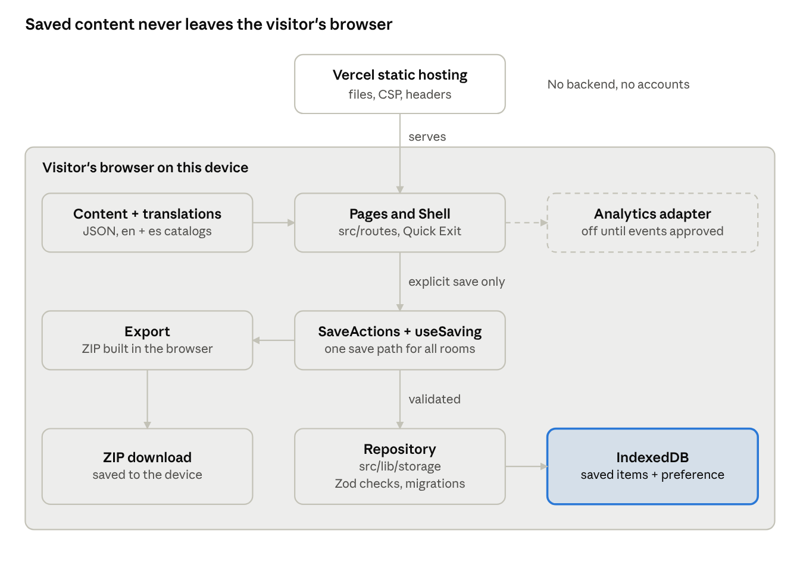

# Army Pink Wellness Portal

Army Pink Wellness Portal is a survivor-centered digital wellness ecosystem providing healing tools, Recovery Rooms, wellness resources, The Healing Library, interactive experiences, trusted partnerships, and opportunities to help survivors move from crisis toward healing, rebuilding, confidence, and freedom.

The Portal is free and anonymous: there are no accounts, and nothing a visitor writes or draws leaves their device unless they download it themselves. It releases on **30 November 2026**.

## Project status

| Area                      | State                                                                                |
| ------------------------- | ------------------------------------------------------------------------------------ |
| Foundation                | Done: static site for Vercel, strict security policy, 92 automated tests             |
| Privacy choice and saving | Done: "Save on This Device" or "Continue Without Saving", My Saved Items, ZIP export |
| Content                   | Placeholder text, moving to reviewed JSON files                                      |
| Spanish                   | Draft for part of the interface; review workflow planned                             |
| Art Room                  | Basic canvas at launch; full experience targeted for 18 December 2026                |

## Documentation

| Document                                                                   | Read it if you want to…                                    |
| -------------------------------------------------------------------------- | ---------------------------------------------------------- |
| [Developer Onboarding](docs/developer-onboarding.md)                       | Start contributing: setup, rules, workflow, best practices |
| [Technical Plan](docs/technical-plan.md)                                   | Understand the architecture, schedule and backlog          |
| [Audit and gap analysis](docs/architecture/0001-audit-and-gap-analysis.md) | See how the original prototype was assessed                |
| [Copy pending approval](docs/decisions/copy-pending-approval.md)           | Check survivor-facing wording awaiting sign-off            |

**New to the project? Start with the [Developer Onboarding guide](docs/developer-onboarding.md).**

## Quick start

You need **Node 22 or newer** and **npm 11 or newer**. npm 10 crashes when installing this project.

```sh
npm install -g npm@11          # once
npm ci                         # install exact dependency versions
npm run dev                    # http://localhost:3000
```

| Command             | What it does                                                           |
| ------------------- | ---------------------------------------------------------------------- |
| `npm run dev`       | Dev server with hot reload                                             |
| `npm run build`     | Production build into `dist/client`, with the security policy added    |
| `npm run preview`   | Serve the build the way Vercel does, on port 4173                      |
| `npm run typecheck` | Strict TypeScript                                                      |
| `npm run lint`      | ESLint and Prettier checks                                             |
| `npm run format`    | Apply Prettier formatting                                              |
| `npm test`          | Unit and component tests (Vitest)                                      |
| `npm run test:e2e`  | Browser tests (Playwright); run `npx playwright install chromium` once |

## How it is built

React 19 with TanStack Router in single-page mode, Tailwind v4 and shadcn/Radix, hosted on Vercel as a static site. There is no backend: saved items live in IndexedDB in the visitor's browser, behind one validated storage layer.



| Path                                 | What lives there                                                                 |
| ------------------------------------ | -------------------------------------------------------------------------------- |
| `src/routes/`                        | One file per page                                                                |
| `src/components/portal/`             | Shell (header, Quick Exit, language), PrivacyChoice, SaveActions, SavingProvider |
| `src/lib/storage/`                   | The only code that reads or writes saved items: schema, database, repository     |
| `src/lib/export/`                    | ZIP export of My Saved Items, built in the browser                               |
| `src/lib/prefs.tsx`, `src/lib/es.ts` | Language setting and draft Spanish                                               |
| `src/data/portal.ts`                 | Placeholder content, moving to JSON                                              |
| `e2e/`                               | Playwright browser tests                                                         |
| `docs/`                              | Plan, onboarding, decisions and audit                                            |

## Contributing

Work happens on a branch per ticket and lands through a reviewed pull request; nobody pushes to `main`. The [Developer Onboarding guide](docs/developer-onboarding.md) covers branching, avoiding merge conflicts, review, handovers and what to do when you're stuck.

**Privacy rules for every change:**

- Never send saved content, typed text or artwork to the network, analytics, logs, URLs or error messages.
- Save only when the visitor presses Save, and only through `<SaveActions>`.
- Don't add requests to other sites (fonts, CDNs, embeds, trackers); the security policy blocks them.
- Don't invent clinical content, partner organizations or translations of sensitive guidance.
- Confirm every destructive action, and never claim Quick Exit erases browsing history.
