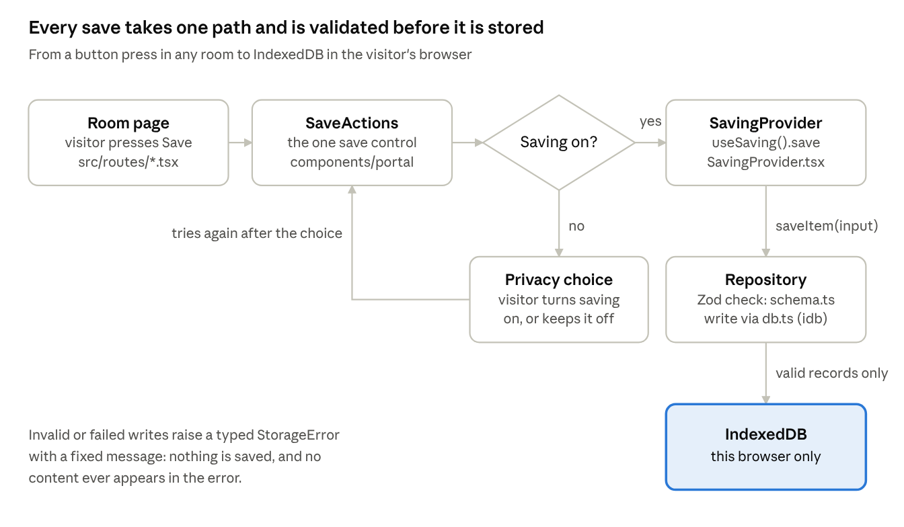

# Wellness Portal — Developer Onboarding

_Last updated 18 October 2026._

## What we are building

The Wellness Portal is a free, anonymous website from Army Pink, a nonprofit supporting survivors of domestic violence. It releases on 30 November 2026. Some visitors may be using a shared or monitored device, so every technical choice starts from their safety.

What visitors find:

- **Calm Room**: grounding and breathing
- **Six Recovery Rooms**
- **Healing Journals, Decision Support and the Survivor Toolkit**
- **Healing Library and "You Are Not Broken" modules**
- **Opportunities and Wellness Partners**
- **Art Room**: "Why I Left → Where I'm Going"
- **My Saved Items**

**Promises the code keeps:**

- **No accounts.** No name, email or login, ever.
- **Saving is optional and explicit.** Visitors choose "Save on This Device" or "Continue Without Saving". Nothing is saved until they press Save.
- **Saved items never leave the browser.** They live in IndexedDB on that device. No server, analytics or error tool receives them.
- **Quick Exit** switches to a neutral site at once. Honest copy says it cannot erase browser history.
- **English and Spanish.** Sensitive guidance appears in Spanish only after a reviewer approves the translation.
- **Accessible and mobile-first.** The target is WCAG 2.2 AA.

The full plan, schedule and backlog are in the [Technical Plan](technical-plan.md). The original audit is `docs/architecture/0001-audit-and-gap-analysis.md` in the repo.

## Your first two hours

Plan two hours to go from zero to a merged first PR. You need Node 22 or newer and npm 11 or newer. npm 10 crashes when installing this project, so upgrade first.

1. Install tools: `npm install -g npm@11`, then check with `node -v` and `npm -v`.
2. Clone the repo from `github.com/armypinknp/wellness-portal` once the team lead has shared access. Check out the current working branch.
3. Install dependencies with `npm ci`.
4. Run `npm run dev` and open `http://localhost:3000`. The intro appears once per browser session.
5. Run the checks: `npm run typecheck`, `npm run lint` and `npm test` (about 40 tests, a few seconds).
6. Install the browser once with `npx playwright install chromium`, then run `npm run test:e2e`. It builds the production site and runs about 52 browser tests on desktop and mobile in under a minute.
7. Try the product as a visitor:
   - choose Save on This Device
   - save something in the Calm Room
   - open My Saved Items, download the ZIP, then delete everything
   - press Quick Exit
8. Read `README.md` and the "Rules you must not break" section below.
9. Pick a `good-first-issue` ticket and open a draft PR within your first week.

| Command                           | What it does                                                        |
| --------------------------------- | ------------------------------------------------------------------- |
| `npm run dev`                     | Dev server with hot reload on port 3000                             |
| `npm run build`                   | Production build into `dist/client`, with the security policy added |
| `npm run preview`                 | Serves the build the way Vercel does, on port 4173                  |
| `npm run typecheck`               | Strict TypeScript                                                   |
| `npm run lint` / `npm run format` | ESLint and Prettier; format before you push                         |
| `npm test`                        | Unit and component tests (Vitest)                                   |
| `npm run test:e2e`                | Browser tests (Playwright) against the production build             |

## How the code fits together

The Portal is a static React app with no backend. Vercel serves the files, and a visitor's saved items live only in IndexedDB in their own browser. Understanding the save path explains most of the codebase.



The app is React 19 with TanStack Router in single-page mode, styled with Tailwind v4 and shadcn/Radix components.

| Folder                               | What lives there                                                        |
| ------------------------------------ | ----------------------------------------------------------------------- |
| `src/routes/`                        | One file per page; keep them thin                                       |
| `src/components/portal/`             | Shared Portal pieces: Shell, PrivacyChoice, SaveActions, SavingProvider |
| `src/components/ui/`                 | shadcn/Radix building blocks: buttons, dialogs                          |
| `src/lib/storage/`                   | Schema, database, repository and errors for saved items                 |
| `src/lib/export/`                    | The ZIP export                                                          |
| `src/lib/prefs.tsx`, `src/lib/es.ts` | Language setting and draft Spanish                                      |
| `src/data/portal.ts`                 | Placeholder content, moving to JSON                                     |
| `e2e/`                               | Playwright browser tests                                                |
| `docs/`                              | Decisions, audit, approvals                                             |

## Rules you must not break

These rules protect people who may be in danger. A PR that breaks one is not merged, however good the rest is. The browser tests enforce several automatically.

**Privacy**

- Never send saved content, typed text, artwork or search terms anywhere: no network, analytics, `console` logs or error messages.
- Never put personal content in a URL or query string.
- Save only when the visitor presses Save. No autosave of reflections or drawings.
- All saving goes through `<SaveActions>` and `useSaving()`. Never call IndexedDB or `localStorage` for personal content.
- Don't add requests to other sites: no fonts, CDNs, embeds or trackers. The security policy blocks them, and the browser tests fail on them.

**Safety**

- Quick Exit must stay visible on every page and work from anywhere.
- Never write copy claiming Quick Exit, deletion or private browsing erases history or guarantees safety.
- Every destructive action needs a confirmation dialog.
- Simulated features (PIN lock, encryption) keep their "Simulated" badge until they are real.

**Content**

- Don't invent clinical guidance, statistics, partner organizations or hotline numbers. Use a labelled placeholder and ask.
- Don't machine-translate sensitive survivor guidance. Mark Spanish as draft until a reviewer approves it.
- Keep the status tags (Placeholder, Needs approval) until the content owner signs off.

**Code safety**

- No `dangerouslySetInnerHTML` with user text.
- Validate anything read from storage or imported, using the Zod schemas in `src/lib/storage/schema.ts`.
- Explain each new dependency in your PR description.

## How we work

The team is volunteers giving about 5 hours a week, so work comes in small tickets and handovers are written down. No one needs to be online at the same time as anyone else.

**The weekly rhythm**

- **Monday:** the team lead assigns tickets for the week. Each ticket is at most 5 hours, and you have one at a time.
- **During the week:**
  - work on a branch named `ap-NN-short-slug`, for example `ap-07-saved-items-grouping`
  - open a draft PR early so others can see progress
- **Friday:** post a short async update: done, next, blocked.
- **Stuck for more than an hour?** Ask in the team channel. Asking early is expected.

**Pull requests**

- One ticket per PR, focused and small. Write "Closes AP-NN" in the description.
- Before you mark it ready, run `npm run format`, `npm run typecheck`, `npm run lint`, `npm test` and `npm run test:e2e`. CI runs them again.
- Add or update a test for what you changed. A storage or privacy change always needs one.
- Include a screenshot of any visual change, on mobile and desktop.
- One approving review is needed. Spend about 1 hour of your 5 reviewing someone else's PR, and answer reviews within 3 days.
- Never push to `main` or force-push a shared branch.

**Can't finish this week?** Push your branch and leave a note in the draft PR: what works, what's left, what you learned. Someone else can pick it up.

## Best practices for contributors

If you're new to team projects, start here. These habits keep work moving when everyone has only a few hours a week, and they prevent the most common problems: merge conflicts, lost work and tasks that stall without anyone noticing.

### Setting up your machine

- **Use the right versions.** You need Node 22 or newer and npm 11 or newer. Installing Node through [nvm](https://github.com/nvm-sh/nvm) lets you switch versions easily. Always install with `npm ci`, not `npm install`: it follows the lockfile exactly, so everyone gets the same packages.
- **Set up Git once.**
  - Run `git config --global user.name "Your Name"` and `git config --global user.email "you@example.com"`.
  - Use the email on your GitHub account so commits link to you.
  - Sign in to GitHub through SSH keys or the GitHub CLI. Never paste a password or token into a file in the project.
- **Use an editor that formats for you.** In VS Code, install the ESLint and Prettier extensions and turn on "format on save". This avoids most lint failures before you even run the checks.
- **Keep secrets out of the project.** The Portal needs no API keys. If you ever create a `.env` file for experiments, it is ignored by Git. Never commit it, and never share it in chat.
- **If setup fails:**
  - check `node -v` and `npm -v` first
  - delete `node_modules` and run `npm ci` again
  - if it still fails, post the exact error message in the team channel

### Working on a branch

Never work directly on `main`. `main` must always be in a working, releasable state, and only reviewed pull requests change it.

1. **Start from the latest `main`.** Run `git checkout main`, then `git pull`.
2. **Create your branch** named after your ticket: `git checkout -b ap-07-saved-items-grouping`.
3. **Commit small and often**, with messages that say what changed and why. For example: "Group saved items by room on My Saved Items", not "fix stuff".
4. **Push your branch early**, even before it's finished: `git push -u origin ap-07-saved-items-grouping`. Your work is then backed up, and others can see it.
5. **Open a draft pull request** as soon as you've pushed. Mark it "Ready for review" when the checks pass.

### Avoiding merge conflicts

A merge conflict happens when two people change the same lines. Most are avoidable.

- **Stay up to date.** At the start of each work session, bring the latest `main` into your branch: `git fetch origin`, then `git merge origin/main`. A small conflict fixed today is much easier than a big one fixed next week.
- **Keep pull requests small.** One ticket, a few files, merged within the week. Long-lived branches are where conflicts grow.
- **Stay inside your ticket.** Don't reformat, rename or "tidy up" files your ticket doesn't need. Unrelated changes are the most common cause of conflicts with other people's work.
- **Say when you'll touch a shared file.** Some files many people need: `src/lib/es.ts`, `src/data/portal.ts`, `package.json`, `src/components/portal/Shell.tsx`. Mention it in the team channel before editing them.
- **If you get a conflict:**
  - Don't panic, and don't delete anything to make it go away.
  - Open the conflicted file, keep both people's intended changes, then run the tests.
  - If you're unsure what the other change was for, ask its author or the team lead before resolving it.
- **Never force-push** (`git push --force`) to a branch someone else is using, and never to `main`.

### Before you ask for review

- Run `npm run format`, `npm run typecheck`, `npm run lint`, `npm test` and `npm run test:e2e`. If they pass on your machine, CI will almost always pass too.
- Try your change in the browser yourself, on a narrow (phone-sized) window as well as a wide one.
- Read your own diff on GitHub once before requesting review. You'll often catch a leftover `console.log` or a stray file.
- In the PR description, say what you changed, how you tested it, and anything you're unsure about. Reviewers are volunteers too; a clear description saves them time.

### Giving and receiving review

- **When reviewing,** be kind and specific: "This could save twice if the button is double-clicked. Disable it while saving?" is better than "this is wrong". Ask questions instead of assuming.
- **When receiving review,** comments are about the code, not about you. Reply to each one: either change it, or explain why not. If you disagree, discuss it; the team lead can make the call.
- **Approve only what you've actually checked.** If you only reviewed part of a PR, say which part.

### When you're stuck

Being stuck is normal, especially in a new codebase. Waiting silently is the only real mistake.

1. Spend up to **30 minutes** trying yourself: read the error carefully, search the codebase for similar code, check `README.md` and this guide.
2. If you're still stuck after **one hour**, ask in the team channel. Include what you're trying to do, what you tried, and the exact error message or a screenshot.
3. If you have no answer within a day, or the problem blocks your ticket, **contact the team lead directly.**
4. If you realise your ticket is bigger than 5 hours, tell the team lead early. Splitting a ticket is normal, not a failure.

Never work around a privacy or safety rule to get unstuck. Ask first.

### Handing over work

People's availability changes, and that's fine. What matters is that work is never lost or left in limbo.

**When a task is finished:**

- Make sure the PR is merged, or approved and waiting for the team lead to merge it.
- Tick the ticket's acceptance criteria and add a one-line note: what was done, and anything the next person should know.
- Delete your branch after the merge. GitHub offers a button for this.

**When you can't finish a task:**

- Tell the team lead as soon as you know, ideally before Friday's update.
- Push everything you have, even if it doesn't work yet, and keep the PR as a draft.
- Write a handover note in the PR description, using these four headings:
  - **Done:** what works and is tested
  - **Left to do:** the remaining steps, as a short checklist
  - **Watch out for:** anything surprising you found, dead ends you already tried
  - **How to test:** the commands or clicks that show it working
- Unassign yourself from the ticket so the team lead can reassign it.

**When you pick up someone else's task:**

- Read their handover note and the PR before writing any code.
- Continue on their branch rather than starting over, unless the team lead agrees otherwise.
- If something in the note is unclear, ask the previous owner. A short question saves hours.

### Looking after yourself

This project deals with domestic violence, and some content may be hard to read. It's fine to skip a ticket that involves difficult material: tell the team lead and pick another one. Take breaks, keep to the hours you can give, and don't feel you have to catch up in one long session.

## Common tasks

Most tickets are one of these four tasks. Each has one correct place in the code.

**Let a visitor save something from a room.** Render `SaveActions` with a typed item. It handles the privacy choice, errors and the success message.

```tsx
<SaveActions
  item={{
    kind: "reflection", // reflection | artwork | exercise | resource
    roomId: "journals", // kebab-case
    activityId: "letting-go",
    room: "Healing Journals", // English label, translated when shown
    activity: "Letting go",
    source: "/journals", // must be a Portal path
    payload: { text },
  }}
/>
```

For artwork, pass a function that returns the item, so the canvas is read only when the visitor presses Save. See `src/routes/art-room.tsx`.

**Add or change interface text.**

- Today: wrap it in `tx("English text")` and add a draft Spanish entry in `src/lib/es.ts` with the same English key.
- After TR-01 lands: add a key to `en.json` and `es.json` instead.
- Never edit an English string without updating its Spanish entry. `src/test/translations.test.ts` catches this on the safety screens.

**Add or change content.** Today content lives in `src/data/portal.ts`. AP-13 moves it to typed JSON in `src/content/`, and each file is checked against a Zod schema. Real content comes from the content owner; until then, keep placeholders labelled.

**Add a test.**

| What you changed                            | Test type                         | Where                                                                                      |
| ------------------------------------------- | --------------------------------- | ------------------------------------------------------------------------------------------ |
| Storage, validation, export                 | Unit (Vitest)                     | Next to the code, such as `src/lib/storage/repository.test.ts`                             |
| A component's behaviour                     | Component (React Testing Library) | `src/test/*.test.tsx`                                                                      |
| A flow across pages, or a privacy guarantee | Browser (Playwright)              | `e2e/*.spec.ts`; use the shared `fixtures.ts`, which fails on errors and off-site requests |

## Glossary and where to find things

| Term             | Meaning                                                                                      |
| ---------------- | -------------------------------------------------------------------------------------------- |
| Privacy choice   | The "YOUR PRIVACY, YOUR CHOICE" screen: Save on This Device or Continue Without Saving       |
| Saved item       | A record the visitor explicitly kept: `reflection`, `artwork`, `exercise` or `resource`      |
| Repository       | `src/lib/storage/repository.ts`, the only code that reads or writes saved items              |
| Quick Exit       | Button (and Esc, outside text fields and dialogs) that replaces the page with a neutral site |
| Status tag       | Labels on unfinished content: Confirmed, Provisional UX, Placeholder, Needs approval         |
| Sensitive string | Survivor guidance or safety copy; shown in Spanish only after approval                       |
| D1–D6            | Architecture decisions taken on 18 Oct 2026; see the [Technical Plan](technical-plan.md)     |
| AP-NN / TR-NN    | Backlog ticket IDs; TR tickets are the Spanish translation feature                           |

| Need                                        | Look here                                          |
| ------------------------------------------- | -------------------------------------------------- |
| Plan, schedule, backlog                     | [`docs/technical-plan.md`](technical-plan.md)      |
| Why things are the way they are             | `docs/architecture/0001-audit-and-gap-analysis.md` |
| Copy waiting for approval                   | `docs/decisions/copy-pending-approval.md`          |
| Setup and scripts                           | `README.md`                                        |
| A page                                      | `src/routes/<page>.tsx`                            |
| Header, footer, Quick Exit, language toggle | `src/components/portal/Shell.tsx`                  |
| Privacy choice, Save button, saving state   | `src/components/portal/`                           |
| Security headers and policy                 | `vercel.json`, `scripts/inject-csp.mjs`            |
