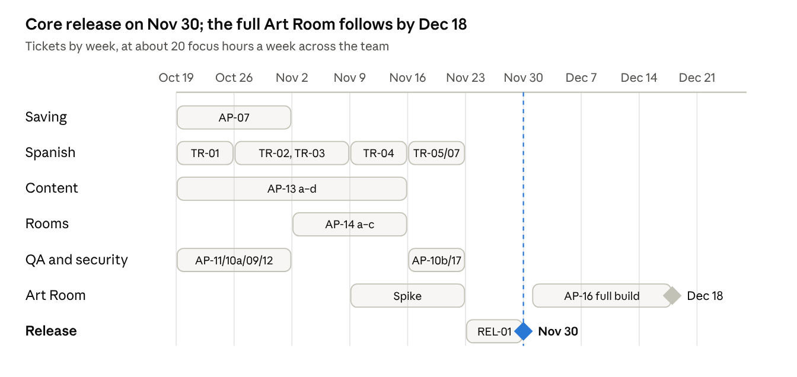

# Army Pink Wellness Portal — Technical Plan

_Last updated 18 October 2026. Developers: start with the [Developer Onboarding guide](developer-onboarding.md)._

## Executive summary

The Wellness Portal is a free, anonymous website that Army Pink is building for survivors of domestic violence. It releases on **30 November 2026**. Visitors can calm down, reflect, learn, find opportunities and create art without creating an account. Anything they choose to save stays on their own device.

- **Where we are.** The foundation is complete and tested, about two weeks ahead of the original schedule. The site builds and runs, the privacy choice and device-only saving work end to end, and 92 automated tests pass. Most content is still placeholder text.
- **How it is built.** The Portal is a static website with no backend server. That one decision removes the biggest privacy risk, a central store of survivors' data, and keeps the project cheap and simple for a volunteer team to run. Section 4 explains why.
- **What happens next.** Six workstreams run in parallel over six weeks: saving polish, Spanish translation, real content, the recovery rooms, quality and security, and release.
- **What changed in scope.** The developers are volunteers giving about 5 hours a week. The full interactive Art Room therefore moves to a second milestone, targeted for 18 December. The basic Art Room canvas ships at launch.
- **What we need from leadership.**
  - confirmation of how many volunteers are active
  - an owner for real content and for Spanish review
  - approval of the survivor-facing wording listed in section 11

## About this document

This is the working technical plan for the Portal. It is written for Army Pink leadership, volunteer developers, and anyone reviewing the project. No prior knowledge of the codebase is assumed. New developers should also read the separate [Developer Onboarding guide](developer-onboarding.md).

| Section                              | What you will find                                             | Most useful for          |
| ------------------------------------ | -------------------------------------------------------------- | ------------------------ |
| 1. Where the project stands          | Progress at a glance                                           | Everyone                 |
| 2. What has been built               | Work completed so far, compared with the original plan         | Leadership, reviewers    |
| 3. How the Portal is built           | A diagram of the parts and the technology used                 | Developers               |
| 4. Why a static site with no backend | The reasoning behind the core architecture, and its trade-offs | Everyone                 |
| 5. Key decisions                     | Six design decisions and their reasons                         | Leadership, developers   |
| 6. Spanish translation               | How Spanish will be added and reviewed safely                  | Leadership, content team |
| 7. Team capacity                     | How much work fits in volunteers' time                         | Leadership               |
| 8. Schedule                          | Week-by-week timeline to release                               | Everyone                 |
| 9. Work backlog                      | Every task, its size and its acceptance criteria               | Developers               |
| 10. Release criteria                 | What must pass before launch                                   | Leadership, reviewers    |
| 11. Risks and approvals              | What could go wrong, and decisions needed                      | Leadership               |

**Reading the IDs.** Tasks are numbered so they can be tracked:

- **AP-** marks a general Portal task, such as AP-07.
- **TR-** marks a translation task.
- **D1 to D6** are design decisions, explained in section 5.

Weeks are written W1 to W6, starting Monday 19 October 2026.

## 1. Where the project stands

The Portal's foundation was finished and tested on 18 October 2026, about two weeks ahead of the original plan. The first version was a clickable prototype made with Lovable, an AI website builder; the code no longer depends on it.

The Portal now builds as a static website for Vercel, the hosting service. It saves only when a visitor presses Save, and it passes 40 unit and component tests and 52 browser tests.

The code is on a working branch awaiting review, and nothing has been deployed to the public site yet. The rest of this plan is sized for volunteers giving about 5 hours a week.

| Area                      | State on 18 Oct                                                                                    |
| ------------------------- | -------------------------------------------------------------------------------------------------- |
| Framework and hosting     | Done: React + TanStack Start in static SPA mode, Vercel config                                     |
| Privacy choice and saving | Done: two-choice screen, device-only storage, My Saved Items, ZIP export, delete with confirmation |
| Security baseline         | Done: strict CSP, security headers, no third-party requests, no Lovable telemetry                  |
| Testing                   | Done: Vitest, React Testing Library, Playwright on desktop and mobile                              |
| Content                   | Placeholder; still TypeScript constants, not JSON                                                  |
| Spanish                   | Draft dictionary for part of the UI; no review workflow yet                                        |
| Art Room                  | Basic three-stage canvas with save; full experience not started                                    |

## 2. What has been built

Before building anything, the Lovable prototype was audited to see what it already did well and what needed fixing. The audit is in `docs/architecture/0001-audit-and-gap-analysis.md`. The table compares what the original plan asked for with what has been built.

| Change                | Original plan                    | What was built                                                                                                                                          | Plan ticket          |
| --------------------- | -------------------------------- | ------------------------------------------------------------------------------------------------------------------------------------------------------- | -------------------- |
| Repository foundation | Clean up the export              | Local git repo with history in focused commits; npm 11 required (npm 10 crashes on this dependency tree); Prettier and ESLint at 0 errors               | AP-01, AP-02         |
| Build and hosting     | Vercel, retain framework         | Lovable build wrapper removed; static SPA output in `dist/client`; `vercel.json` rewrites, cache and security headers                                   | AP-03, D1, D2        |
| Data contract         | `SavedItem` with `schemaVersion` | v2 record: `kind`, `roomId`, `activityId`, timestamps, per-kind payload; Zod limits (50,000 characters of text, about 6 MB per artwork)                 | AP-04                |
| Storage               | IndexedDB via `idb`              | One repository: save, list, get, delete, clear, export; prototype records migrated automatically; unreadable records skipped; content-free typed errors | AP-05                |
| Shared saving API     | One provider and hook            | `SavingProvider` + `useSaving()` on the repository; all 9 save points use one typed `SaveActions`                                                       | AP-06                |
| Export                | ZIP with manifest                | ZIP built in the browser: readable `index.html`, `manifest.json`, image files; nothing uploaded                                                         | AP-08, D3            |
| Privacy choice        | Two buttons, no Skip             | Kept; intro links renamed "Skip intro" and always lead to the choice; keep-or-delete prompt when saving is turned off                                   | AP-03 (plan), D5, D6 |
| Quick Exit            | Neutral page, no history claim   | Esc no longer exits while typing, drawing or with a dialog open; button always works                                                                    | D4                   |
| Security              | CSP, safe rendering              | Strict hash-based script policy; Google Fonts self-hosted; Lovable error reporting removed; saved links limited to Portal paths                         | AP-09 (part)         |
| Brand assets          | Not covered                      | Logos and images bundled with the app; they were hosted by Lovable before                                                                               | None                 |
| Tests                 | Vitest, RTL, Playwright          | 40 unit/component and 52 browser tests, all passing                                                                                                     | AP-10 (part)         |
| Spanish               | Key-based i18n                   | Draft Spanish added for the intro and the D5 dialog; a broken intro translation fixed; test that fails if a safety-screen string loses its Spanish      | New: TR tickets      |
| Documentation         | Runbooks and ADRs                | Volunteer README, audit and decision record, copy-approval checklist                                                                                    | Docs                 |

## 3. How the Portal is built

The Portal is a static React app with no backend: Vercel serves files, and everything a visitor saves stays in IndexedDB in their browser.

Pages save only through `SaveActions`. The repository validates every record before writing, and the analytics adapter stays a no-op until the event list is approved.

| Layer        | Technology                                                      | Location                                |
| ------------ | --------------------------------------------------------------- | --------------------------------------- |
| UI           | React 19, TanStack Router (SPA mode), Tailwind v4, shadcn/Radix | `src/routes`, `src/components`          |
| Storage      | IndexedDB via `idb` 8, Zod 3 schemas                            | `src/lib/storage`                       |
| Export       | `fflate` ZIP, built in the browser                              | `src/lib/export`                        |
| Translations | Draft dictionary today; typed JSON catalogs in TR-01            | `src/lib/prefs.tsx`, `src/lib/es.ts`    |
| Hosting      | Vercel static output, CSP and headers                           | `vercel.json`, `scripts/inject-csp.mjs` |
| Tests        | Vitest + React Testing Library; Playwright desktop + mobile     | `src/**/*.test.*`, `e2e/`               |

## 4. Why a static site with no backend

The Portal has no server of its own and no database. Vercel delivers the same files to every visitor, and everything personal happens inside the visitor's browser. This is a deliberate safety decision, not a shortcut.

**What these terms mean.**

- **Backend:** a server the organization runs. Most websites have one to store accounts and user data in a central database.
- **Static site:** a set of files (pages, images, code) delivered the same way to everyone, with no server-side processing and no central data store.

**Why it is the right choice for this Portal.**

1. **The safest data is data we never hold.** Some visitors may be using a device that someone else monitors. With a backend, every saved reflection or drawing would also sit in an Army Pink database. That copy could be breached, misconfigured or legally demanded, and it would need protecting indefinitely. Keeping saved items only on the visitor's device means there is no central store of survivors' information to lose.
2. **The requirements leave a server nothing to do.** The founder has ruled out accounts, logins, names, emails, cloud sync and emailing saved items. Those are the usual reasons to have a backend. Without them, a server would add risk and cost without adding value.
3. **The content is public and changes slowly.** Library articles, learning modules, Opportunities and partner listings are the same for every visitor. They are stored as reviewed files in the code repository and published with the site, so no database or admin system is needed.
4. **It fits a volunteer team.**
   - There is no server to patch, back up or monitor, and no out-of-hours outages.
   - Hosting costs are low.
   - Any developer who knows React can contribute.
   - A bad release can be rolled back in one step.
5. **It is more secure by design.** There are no login pages or APIs to attack and no stored user data to steal. The site's security policy also blocks it from sending data to other websites, and automated tests check this on every page.

**The trade-offs.**

| Trade-off                                     | What it means for visitors and staff                                                   | How the plan handles it                                                            |
| --------------------------------------------- | -------------------------------------------------------------------------------------- | ---------------------------------------------------------------------------------- |
| Saved items live in one browser on one device | They don't follow the visitor to another device, and clearing browser data erases them | The privacy screen says this plainly; visitors can download a ZIP copy at any time |
| Content updates need a code change            | Non-technical staff can't edit pages directly                                          | Content is reviewed through GitHub; a content management system can be added later |
| Analytics are limited                         | Only anonymous, approved events can be counted                                         | Vercel Web Analytics with an allowlist of event names (AP-12), off until approved  |

**When a backend would be added.** Only if leadership approves a feature that truly needs one, and only after a privacy review. Examples:

- a public, moderated Art Room gallery
- a content management system so staff can edit content directly
- syncing saved items across devices

The plan then favours a small managed service, such as Supabase or Neon behind Vercel Functions, over a custom server.

## 5. Key decisions

Six decisions were taken on 18 October and are implemented. Changing one needs a new decision record in `docs/decisions/`.

| ID  | Decision                                                                                               | Why                                                                                             | Still open                                                                      |
| --- | ------------------------------------------------------------------------------------------------------ | ----------------------------------------------------------------------------------------------- | ------------------------------------------------------------------------------- |
| D1  | Static SPA on Vercel; no server runtime                                                                | No feature needs a server; the simplest security policy; no beta server framework in production | None                                                                            |
| D2  | Detach from Lovable now                                                                                | Volunteers need a normal Vite setup they can read and debug                                     | Lovable can still be used for throwaway stakeholder mock-ups, outside this repo |
| D3  | Export as ZIP: readable HTML, JSON manifest, images                                                    | Readable on any device and still machine-readable for a future re-import                        | Check how phones handle the ZIP during QA                                       |
| D4  | Esc exits except in dialogs, text fields and the canvas                                                | A stray key press must not lose a survivor's writing                                            | Founder approval of the explanatory copy                                        |
| D5  | Turning saving off asks "Keep my saved items" or "Delete them now"; delete needs a second confirmation | Makes what happens to existing items explicit                                                   | Founder approval of the dialog copy                                             |
| D6  | Intro skip links say "Skip intro" and lead to the privacy choice                                       | The privacy choice can never be bypassed                                                        | None                                                                            |

## 6. Spanish translation

Goal for 30 November: every interface string is available in Spanish, and no survivor-facing guidance appears in Spanish until a reviewer approves it. Translation is done by people. Machine translation may only be used to make a first draft, and that draft is always reviewed.

**Where it starts.** The prototype has two lookups. `useT()` reads a small keyed dictionary, and `useTx()` uses the English sentence itself as the key into a draft `es.ts`. Using the sentence as the key breaks silently: if someone edits the English, the Spanish disappears. That happened to the intro's Quick Exit line. There is no review status, and nothing reports missing strings.

**Design.**

1. **Message catalogs as JSON:** `src/content/i18n/en.json` and `es.json`. Each entry has a stable key such as `intro.quickExit.body`, grouped by feature.
2. **Typed lookups:** `t("intro.quickExit.body")`. Key names come from `en.json`, so a typo fails the typecheck. There is no new dependency; this extends the existing `prefs.tsx`.
3. **Review status per Spanish string:** `draft`, `reviewed` or `approved`. Each string is also tagged `general` or `sensitive`. Sensitive strings cover safety guidance, clinical wording and the privacy warnings.
4. **What a Spanish visitor sees:**
   - general strings: draft or better Spanish
   - sensitive strings: approved Spanish only
   - anything else: the English text with a short notice, using the existing `TranslationNote`
5. **Content JSON (Library, modules, Opportunities):** each record carries per-locale fields and a `translationStatus`, following the same rule.
6. **Translator workflow without Git:**
   - `npm run i18n:export` writes a CSV for reviewers: key, English, Spanish, status, notes.
   - `npm run i18n:import` validates their edits and writes them back.
7. **Automated checks:**
   - CI fails on a missing key or a placeholder mismatch.
   - A coverage report lists draft and untranslated strings by area.
   - Playwright runs the main routes in Spanish to catch overflow; Spanish text runs about 25–30% longer.
8. **Language state:** the choice stays in a single `localStorage` setting.
   - `<html lang>` follows the choice, so screen readers pronounce Spanish correctly.
   - Dates use `Intl` for the chosen language.

**Tickets.**

| ID    | Ticket                            | Acceptance criteria                                                                              | Hours           |
| ----- | --------------------------------- | ------------------------------------------------------------------------------------------------ | --------------- |
| TR-01 | Typed catalog and `t()`           | `en.json`/`es.json` load; typecheck fails on an unknown key; `<html lang>` follows the choice    | 5               |
| TR-02 | Move existing strings to keys     | All `useTx()` sentence-key calls replaced; existing draft Spanish carried over; one PR per area  | 10 (5 PRs × 2)  |
| TR-03 | Status and sensitive fallback     | Sensitive strings show English plus a notice unless approved; unit tests for every status        | 4               |
| TR-04 | Export/import and coverage report | CSV round trip loses nothing; CI fails on missing keys                                           | 5               |
| TR-05 | Spanish layout QA                 | Playwright runs every route in Spanish on mobile and desktop with no overflow or clipped buttons | 4               |
| TR-06 | Native-speaker review             | Two reviewers mark every general string `reviewed`; the founder approves sensitive strings       | Content team, 8 |
| TR-07 | Spanish content records           | Library, module and Opportunities JSON carry Spanish fields with status                          | 6 (after AP-13) |

No Spanish is shown for any clinical or safety content until TR-06 marks it approved.

## 7. Team capacity

The team has about 20 focused hours a week. This assumes 6 volunteers at 5 hours each, of which about two-thirds goes into tickets; the rest is code review, questions and context switching. With 5.5 working weeks to 29 November, that is about 110 focus hours. Thanksgiving week counts as half.

| Input                     | Value    | Note                                                             |
| ------------------------- | -------- | ---------------------------------------------------------------- |
| Volunteer developers      | 6        | Assumption; recalculate when the roster is known                 |
| Hours per person per week | 5        | Average stated by the team lead                                  |
| Share spent on tickets    | 67%      | Remainder covers review, questions and setup                     |
| Focus hours per week      | 20       | 6 × 5 × 0.67                                                     |
| Weeks to release          | 5.5      | 19 Oct–29 Nov, Thanksgiving week at half                         |
| Focus hours to release    | 110      |                                                                  |
| Remaining release scope   | 104      | Backlog below, excluding the full Art Room                       |
| Buffer                    | 6 h (5%) | Very thin: with fewer than 6 people, defer AP-12 and TR-07 first |

**Working rules that make 5-hour weeks work.**

- **Ticket size:** a ticket is at most 5 hours, one person's week. Anything bigger is split before it is assigned.
- **One ticket per person:** each person has one ticket in progress. Unfinished work is handed over with a draft PR and a note, never held for weeks.
- **Review time:** reviews are answered within 3 days. Each person spends about 1 hour of their 5 reviewing someone else's PR.
- **Separate files:** tickets are cut so two people rarely touch the same files. The storage layer and `SaveActions` are stable, so feature work can run in parallel.
- **Weekly cadence:** the lead assigns tickets on Monday, and progress is checked in a 15-minute async update on Friday.

## 8. Schedule

The core Portal releases on 30 November in English and Spanish. The full Art Room becomes a separate milestone with a target of 18 December, because the original plan's Art Room work does not fit in 5-hour weeks before then.

Phases now run as parallel workstreams rather than in sequence. Week 6 holds only stabilization because of Thanksgiving. At launch the Art Room ships its current three-stage canvas, labelled as an early version.

| Phase                                     | Original dates         | Revised dates           | State                 |
| ----------------------------------------- | ---------------------- | ----------------------- | --------------------- |
| 0 Audit and alignment                     | 19–23 Oct              | 18 Oct                  | Done                  |
| 1 Shared foundation                       | 26–30 Oct              | 18 Oct                  | Done                  |
| 2 Saving MVP                              | 2–6 Nov                | 18 Oct; polish in W1–W2 | Done; AP-07 remaining |
| 3 Core experiences and content            | 9–13 Nov               | W1–W4                   | Planned               |
| Spanish translation (new)                 | Not planned            | W1–W5                   | Planned               |
| 4 Opportunities, partners, Art Room spike | 16–20 Nov              | W3–W5                   | Planned               |
| 5 Testing, security, release readiness    | 23–25 Nov              | W5–W6                   | Partly in place       |
| 6 Stabilization and release               | 26–30 Nov              | W6, release 30 Nov      | Planned               |
| Art Room full build                       | 23–25 Nov, if feasible | 1–18 Dec                | Moved                 |

## 9. Work backlog

Release scope is 104 developer hours in tickets of 5 hours or less, ordered by week. AP-01 to AP-06 and AP-08 are done. TR-06 is review work for the content team and is not counted in developer hours.

| Week | ID     | Ticket                                      | Workstream    | Hours    | Depends on | Acceptance criteria                                                |
| ---- | ------ | ------------------------------------------- | ------------- | -------- | ---------- | ------------------------------------------------------------------ |
| W1   | AP-11  | CI workflow                                 | QA & security | 3        | None       | Every PR runs typecheck, lint, unit and browser tests              |
| W1   | TR-01  | Typed catalog and `t()`                     | Spanish       | 5        | None       | Unknown key fails typecheck; `<html lang>` follows choice          |
| W1   | AP-07a | My Saved Items: group by room and activity  | Saving        | 3        | None       | Grouped list; filter keeps working; component test                 |
| W1   | AP-10a | Accessibility checks with axe               | QA & security | 3        | None       | No serious or critical axe findings on any route                   |
| W1   | AP-13a | Content schemas (Zod) for JSON              | Content       | 4        | None       | Schemas for library, modules, opportunities, partners, calm media  |
| W2   | AP-07b | Saved Items: empty, error and reopen states | Saving        | 3        | AP-07a     | Tests for empty, storage-error and missing-item cases              |
| W2   | TR-02a | Move shell and privacy strings to keys      | Spanish       | 4        | TR-01      | No sentence keys left in those files                               |
| W2   | AP-13b | Healing Library as JSON                     | Content       | 4        | AP-13a     | Library pages read JSON; `data/portal.ts` entries removed          |
| W2   | AP-09  | Remaining security items                    | QA & security | 4        | None       | Unused dependencies and components removed; dependency audit clean |
| W2   | AP-12  | Analytics allowlist adapter (off)           | QA & security | 5        | None       | Rejects unknown events and free text; stays a no-op                |
| W3   | TR-02b | Move room and library strings to keys       | Spanish       | 6        | TR-01      | Three PRs, one per area                                            |
| W3   | AP-13c | Modules and Opportunities as JSON           | Content       | 4        | AP-13a     | Existing Opportunities categories preserved                        |
| W3   | AP-14a | Recovery Rooms on shared components         | Rooms         | 4        | AP-13a     | Room pages use the shared card and SaveActions                     |
| W3   | TR-03  | Review status and sensitive fallback        | Spanish       | 4        | TR-01      | Sensitive strings show English plus a notice until approved        |
| W4   | AP-13d | Calm Room and partners as JSON              | Content       | 4        | AP-13a     | No invented partners; placeholders stay labelled                   |
| W4   | AP-14b | Calm Room and Journals on shared components | Rooms         | 4        | AP-13d     | Media player accessible by keyboard; captions placeholder kept     |
| W4   | AP-14c | Decision Support and Toolkit cleanup        | Rooms         | 4        | None       | Simulated PIN keeps its badge; save flow tested                    |
| W4   | TR-04  | Translator CSV export/import and coverage   | Spanish       | 5        | TR-02a     | CSV round trip loses nothing; CI fails on missing keys             |
| W4   | AP-18a | Art Room feasibility spike, part 1          | Art Room      | 3        | None       | Canvas approach chosen; touch and reduced-motion notes             |
| W5   | TR-05  | Spanish layout QA                           | Spanish       | 4        | TR-02b     | Every route in Spanish passes on mobile and desktop                |
| W5   | TR-07  | Spanish fields in content JSON              | Spanish       | 6        | AP-13b–d   | Status per record; fallback rule applied                           |
| W5   | AP-10b | Browser tests per room                      | QA & security | 3        | AP-14a–c   | Each room's save path covered                                      |
| W5   | AP-18b | Art Room spike, part 2 and estimate         | Art Room      | 3        | AP-18a     | Written estimate and ticket split for December                     |
| W5   | AP-17  | Vercel deployment and rollback runbook      | QA & security | 4        | AP-11      | Preview deploy verified; rollback rehearsed once                   |
| W6   | REL-01 | Stabilization and release checklist         | All           | 8        | All above  | Founder acceptance; known-limitations list published               |
| Dec  | AP-16  | Full Art Room experience                    | Art Room      | about 30 | AP-18b     | Split into 5-hour tickets by the spike                             |

Week dates: W1 19–25 Oct, W2 26 Oct–1 Nov, W3 2–8 Nov, W4 9–15 Nov, W5 16–22 Nov, W6 23–29 Nov (half week).

## 10. Release criteria

The 30 November release ships only when every row below passes on the Vercel preview. Rows marked "In place" are already enforced by tests that run on every build.

| Area             | Pass condition                                                                              | State                         |
| ---------------- | ------------------------------------------------------------------------------------------- | ----------------------------- |
| Anonymous access | Both privacy choices reach every route; no name or email fields                             | In place (browser tests)      |
| Local saving     | Saved items survive a reload and reopen at the right activity                               | In place                      |
| Delete           | Single and bulk delete need confirmation and persist                                        | In place                      |
| Export           | ZIP downloads with no network request                                                       | In place                      |
| Storage failure  | Unavailable, full or corrupt storage fails gracefully with no false success                 | In place (unit tests)         |
| No transmission  | No request leaves the Portal's origin on any route                                          | In place (every browser test) |
| Script injection | Injected inline scripts are blocked by the security policy                                  | In place                      |
| Quick Exit       | Button and Esc rules behave as in D4; copy never claims history is erased                   | In place; copy needs approval |
| Accessibility    | No serious axe findings; keyboard-only path through each room; reduced motion respected     | AP-10a, AP-14                 |
| Spanish          | Every route usable in Spanish; sensitive strings approved or shown in English with a notice | TR-01 to TR-07                |
| Mobile           | Main flows pass on the mobile browser profile                                               | In place; extended in AP-10b  |
| Deployment       | Preview-to-production steps and a rehearsed rollback documented                             | AP-17                         |

**Security rules for every PR.**

- No saved content, typed text or artwork in logs, analytics, URLs or error messages.
- No `dangerouslySetInnerHTML` with user text.
- No new third-party request; the CSP blocks them anyway.
- New dependencies need a reason in the PR description.

## 11. Risks and approvals

The biggest risk is capacity. A 6-hour buffer is lost if one volunteer misses two weeks, so scope is cut in a fixed order instead of letting the date slip.

| Risk                                                     | Effect                                   | Response                                                                              |
| -------------------------------------------------------- | ---------------------------------------- | ------------------------------------------------------------------------------------- |
| Fewer than 6 active volunteers, or less than 5 h each    | Release scope does not fit               | Defer in this order: AP-12, TR-07, AP-14c, AP-18b                                     |
| Spanish reviewers not found by W4                        | Sensitive content stays English-only     | Acceptable at launch: the notice explains it; general UI still ships in draft Spanish |
| Real content (Library, Opportunities) not supplied by W3 | Release ships with labelled placeholders | Content owner named in W1; placeholders keep their status tags                        |
| Art Room estimate grows after the spike                  | December milestone slips                 | Ship the current three-stage canvas at launch, clearly labelled                       |
| Reviews pile up                                          | Work sits finished but unmerged          | Reviews answered within 3 days; any member may review                                 |
| Thanksgiving week                                        | About half capacity in W6                | Only stabilization planned for W6                                                     |

**Approvals needed from the founder.** These are listed in `docs/decisions/copy-pending-approval.md`.

- [ ] D5 keep-or-delete dialog copy
- [ ] Esc explanation in the intro, FAQ, privacy page and footer
- [ ] Quick Exit destination (currently weather.com)
- [ ] FAQ answers
- [ ] Draft Spanish for the intro, before it is marked reviewed
- [ ] Analytics Event Dictionary, before AP-12 can be switched on

**Open questions.**

- [ ] How many volunteers are active, and at what hours?
- [ ] Who owns content supply and Spanish review?
- [ ] Are the Figma files still coming, and do they change any existing screens?
